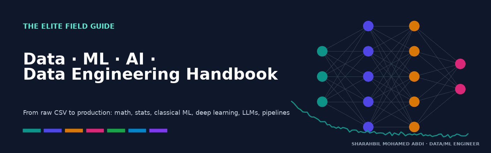
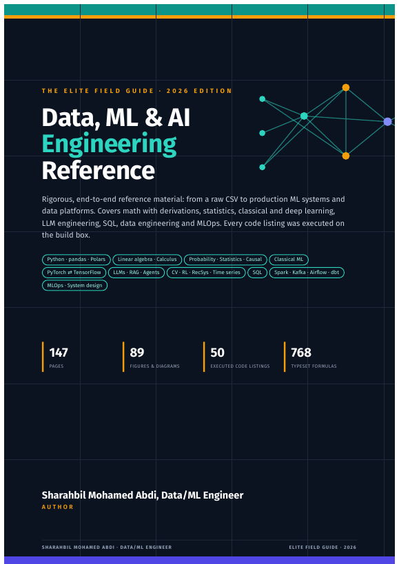
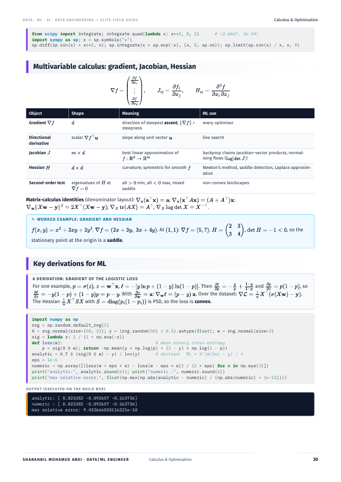
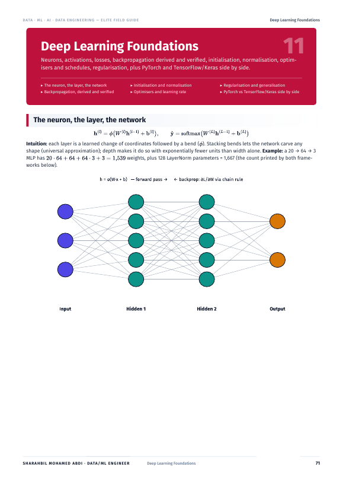
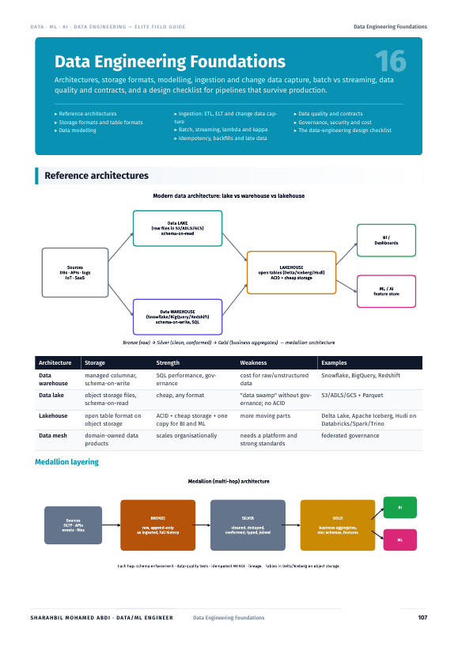

<div align="center">



# Data · ML · AI · Data Engineering Handbook

**The open-source field guide that takes you from a raw CSV to production ML — with the math, the code, and the judgement in between.**

[](https://github.com/T31SHA/data-ml-handbook/actions/workflows/ci.yml)
[](https://t31sha.github.io/data-ml-handbook/)
[](https://github.com/T31SHA/data-ml-handbook/releases/latest)
[](LICENSE)
[](LICENSE-CONTENT)
[](https://github.com/T31SHA/data-ml-handbook/stargazers)
[](CONTRIBUTING.md)

[**📖 Read online**](https://t31sha.github.io/data-ml-handbook/) · [**📄 Download the PDF**](https://github.com/T31SHA/data-ml-handbook/releases/latest) · [**🧪 Run in Colab**](notebooks/) · [**🤝 Contribute**](CONTRIBUTING.md)

</div>

---

## Why this handbook?

Most references give you *either* the theory *or* the code. This one gives you the whole chain for every topic:

> **intuition → math (typeset, derived) → a worked numeric example → runnable code with real output → when to use / when not → pitfalls & interview angles**

| | |
|---|---|
| 📚 **23 sections, 147 pages** | CSV loading & cleaning → classical ML → deep learning (PyTorch **and** TensorFlow/Keras) → LLM engineering → SQL → data engineering → MLOps |
| 🧮 **768 typeset formulas** | Linear algebra, calculus, probability, statistics — each with a plain-language intuition and derivations (backprop, softmax-CE, OLS, bias–variance, √d attention scaling …) |
| 📈 **89 figures** | Loss landscapes, decision boundaries for 8 models, transformer, Spark DAG, medallion & CDC architectures — all regenerable from `figures/src/` |
| ✅ **50 tested snippets** | Every printed code example is executed in CI; the outputs in the book are real |
| 🧭 **Decision flowcharts** | Which model · which metric · which statistical test · which storage engine |
| 🛠️ **Debugging playbooks** | Model not learning, NaN loss, leakage, drift — symptoms → causes → fixes |
| 🎯 **Interview bank & glossary** | 32 interview questions, ~200-term index, 19 one-page cheat cards |

## Preview

<p align="center">
  
  
  
  
</p>

## Contents

| # | Section | Read / Run |
|---|---|---|
| 00 | [How to Use This Guide](content/00_orientation.md) | [docs](https://t31sha.github.io/data-ml-handbook/handbook/00_orientation/) |
| 01 | [Python, NumPy, pandas, Polars & DuckDB](content/01_python.md) | [docs](https://t31sha.github.io/data-ml-handbook/handbook/01_python/) · [](https://colab.research.google.com/github/T31SHA/data-ml-handbook/blob/main/notebooks/01_python.ipynb) |
| 02 | [From CSV to Model: The Workflow](content/02_workflow.md) | [docs](https://t31sha.github.io/data-ml-handbook/handbook/02_workflow/) · [](https://colab.research.google.com/github/T31SHA/data-ml-handbook/blob/main/notebooks/02_workflow.ipynb) |
| 03 | [Worked Project: California Housing, End to End](content/03_project.md) | [docs](https://t31sha.github.io/data-ml-handbook/handbook/03_project/) · [](https://colab.research.google.com/github/T31SHA/data-ml-handbook/blob/main/notebooks/03_project.ipynb) |
| 04 | [Data Visualisation](content/04_viz.md) | [docs](https://t31sha.github.io/data-ml-handbook/handbook/04_viz/) · [](https://colab.research.google.com/github/T31SHA/data-ml-handbook/blob/main/notebooks/04_viz.ipynb) |
| 05 | [Linear Algebra](content/05_linalg.md) | [docs](https://t31sha.github.io/data-ml-handbook/handbook/05_linalg/) · [](https://colab.research.google.com/github/T31SHA/data-ml-handbook/blob/main/notebooks/05_linalg.ipynb) |
| 06 | [Calculus & Optimisation](content/06_calculus.md) | [docs](https://t31sha.github.io/data-ml-handbook/handbook/06_calculus/) · [](https://colab.research.google.com/github/T31SHA/data-ml-handbook/blob/main/notebooks/06_calculus.ipynb) |
| 07 | [Probability, Information Theory & Discrete Maths](content/07_probability.md) | [docs](https://t31sha.github.io/data-ml-handbook/handbook/07_probability/) · [](https://colab.research.google.com/github/T31SHA/data-ml-handbook/blob/main/notebooks/07_probability.ipynb) |
| 08 | [Statistics, Experimentation & Causal Inference](content/08_statistics.md) | [docs](https://t31sha.github.io/data-ml-handbook/handbook/08_statistics/) · [](https://colab.research.google.com/github/T31SHA/data-ml-handbook/blob/main/notebooks/08_statistics.ipynb) |
| 09 | [Classical Machine Learning](content/09_classical_ml.md) | [docs](https://t31sha.github.io/data-ml-handbook/handbook/09_classical_ml/) · [](https://colab.research.google.com/github/T31SHA/data-ml-handbook/blob/main/notebooks/09_classical_ml.ipynb) |
| 10 | [Evaluation, Validation & Tuning](content/10_evaluation.md) | [docs](https://t31sha.github.io/data-ml-handbook/handbook/10_evaluation/) · [](https://colab.research.google.com/github/T31SHA/data-ml-handbook/blob/main/notebooks/10_evaluation.ipynb) |
| 11 | [Deep Learning Foundations](content/11_deep_learning.md) | [docs](https://t31sha.github.io/data-ml-handbook/handbook/11_deep_learning/) · [](https://colab.research.google.com/github/T31SHA/data-ml-handbook/blob/main/notebooks/11_deep_learning.ipynb) |
| 12 | [Architectures: CNNs, RNNs, Transformers](content/12_architectures.md) | [docs](https://t31sha.github.io/data-ml-handbook/handbook/12_architectures/) · [](https://colab.research.google.com/github/T31SHA/data-ml-handbook/blob/main/notebooks/12_architectures.ipynb) |
| 13 | [LLM Engineering](content/13_llm_engineering.md) | [docs](https://t31sha.github.io/data-ml-handbook/handbook/13_llm_engineering/) · [](https://colab.research.google.com/github/T31SHA/data-ml-handbook/blob/main/notebooks/13_llm_engineering.ipynb) |
| 14 | [Applied AI: Vision, Generative, RL, RecSys, Time Series, Anomalies, Fairness](content/14_applied_ai.md) | [docs](https://t31sha.github.io/data-ml-handbook/handbook/14_applied_ai/) · [](https://colab.research.google.com/github/T31SHA/data-ml-handbook/blob/main/notebooks/14_applied_ai.ipynb) |
| 15 | [SQL for Analytics & Engineering](content/15_sql.md) | [docs](https://t31sha.github.io/data-ml-handbook/handbook/15_sql/) · [](https://colab.research.google.com/github/T31SHA/data-ml-handbook/blob/main/notebooks/15_sql.ipynb) |
| 16 | [Data Engineering Foundations](content/16_data_engineering.md) | [docs](https://t31sha.github.io/data-ml-handbook/handbook/16_data_engineering/) · [](https://colab.research.google.com/github/T31SHA/data-ml-handbook/blob/main/notebooks/16_data_engineering.ipynb) |
| 17 | [Spark, Kafka, Airflow & dbt](content/17_big_data_tools.md) | [docs](https://t31sha.github.io/data-ml-handbook/handbook/17_big_data_tools/) |
| 18 | [MLOps & Production ML System Design](content/18_mlops.md) | [docs](https://t31sha.github.io/data-ml-handbook/handbook/18_mlops/) · [](https://colab.research.google.com/github/T31SHA/data-ml-handbook/blob/main/notebooks/18_mlops.ipynb) |
| 19 | [Debugging Playbooks](content/19_debugging.md) | [docs](https://t31sha.github.io/data-ml-handbook/handbook/19_debugging/) · [](https://colab.research.google.com/github/T31SHA/data-ml-handbook/blob/main/notebooks/19_debugging.ipynb) |
| 20 | [Platform Toolbox: Git, Docker, Kubernetes, Cloud, Linux](content/20_platform.md) | [docs](https://t31sha.github.io/data-ml-handbook/handbook/20_platform/) |
| 21 | [Decision Flowcharts](content/21_decisions.md) | [docs](https://t31sha.github.io/data-ml-handbook/handbook/21_decisions/) |
| 22 | [Reference: Formula Sheet, Interview Bank & Glossary](content/22_reference.md) | [docs](https://t31sha.github.io/data-ml-handbook/handbook/22_reference/) |

## Quickstart

**Just read it:** [online docs](https://t31sha.github.io/data-ml-handbook/) or the [latest PDF release](https://github.com/T31SHA/data-ml-handbook/releases/latest).

**Run the examples locally:**

```bash
git clone https://github.com/T31SHA/data-ml-handbook.git && cd data-ml-handbook
python -m venv .venv && source .venv/bin/activate
pip install -r requirements.txt
make test            # executes every snippet in code/ (≈4 min on a laptop CPU)
```

Or open any notebook in [`notebooks/`](notebooks/) with one click in Google Colab.

## Build it yourself

| Command | What it does |
|---|---|
| `make pdf` | Renders math with MathJax (Node) → HTML → PDF via WeasyPrint → `dist/Data-ML-Handbook.pdf` |
| `make docs` / `make serve` | Builds / live-serves the MkDocs Material site |
| `make test` | Runs all snippets with pytest |
| `make outputs` | Re-executes snippets and refreshes the outputs printed in the book |
| `make figures` | Regenerates all figures from `figures/src/` |
| `make notebooks` | Regenerates Colab notebooks from `code/` |

Requirements: Python ≥ 3.10, Node ≥ 18, Graphviz (for flowcharts) and the WeasyPrint system libraries (Pango). On Ubuntu:
`sudo apt install graphviz libpango-1.0-0 libpangoft2-1.0-0 fonts-dejavu`. Fira Sans / IBM Plex Mono are used if installed (`make fonts`).

## Repository layout

```
content/      23 numbered Markdown sections — the single source of truth
figures/      SVG/PNG figures  ·  figures/src/ = the scripts that draw them
code/         runnable snippets (+ sql/, out/ = captured outputs shown in the book)
notebooks/    Colab-ready notebooks, one per section (generated)
build/        PDF pipeline: build_pdf.py, style.css, cover.html, MathJax renderer
docs/         MkDocs Material site (handbook pages are generated from content/)
tests/        pytest suite that executes every snippet and checks every include
```

## Contributing

Found an error, a clearer derivation, or a missing topic? Contributions are very welcome — see [CONTRIBUTING.md](CONTRIBUTING.md),
pick a [`good first issue`](https://github.com/T31SHA/data-ml-handbook/labels/good%20first%20issue), and check the [ROADMAP](ROADMAP.md).
Please follow the [Code of Conduct](CODE_OF_CONDUCT.md).

## Star history

[](https://star-history.com/#T31SHA/data-ml-handbook&Date)

## Citation

If this handbook helps your work or teaching, please cite it (see [CITATION.cff](CITATION.cff)):

```bibtex
@misc{abdi2026datamlhandbook,
  author = {Abdi, Sharahbil Mohamed},
  title  = {Data/ML Handbook: The Elite Field Guide},
  year   = {2026},
  url    = {https://github.com/T31SHA/data-ml-handbook}
}
```

## License

Code (`code/`, `build/`, `figures/src/`, `tests/`) is [MIT](LICENSE). Written content and figures are [CC BY 4.0](LICENSE-CONTENT).

---

<div align="center">

**SHARAHBIL MOHAMED ABDI · DATA/ML ENGINEER**  
[@T31SHA](https://github.com/T31SHA)

If this saved you time, please ⭐ the repo — it helps others find it.

</div>
